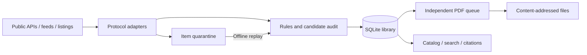

# Quant Research Collector

[English](README.md) | [简体中文](README.zh-CN.md)

[](#quick-start)
[](#quick-start)
[](#highlights)

**Build a local, auditable library of quantitative finance papers and research reports.**

Discover research through public APIs, RSS and static institution pages. Filter it with explicit rules, retain metadata and versions, and archive publicly accessible PDFs. Resume interrupted work, inspect rejected candidates, and export citations without model calls or paid API dependencies.

> **Scope:** a personal research collection pipeline. Free metadata does not guarantee a free PDF, and a completed API window does not establish complete historical coverage.

## Contents

- [Highlights](#highlights)
- [Quick start](#quick-start)
- [Common workflows](#common-workflows)
- [Research sources](#research-sources)
- [How it works](#how-it-works)
- [Configuration](#configuration)
- [Commands and exit codes](#commands-and-exit-codes)
- [Library and exports](#library-and-exports)
- [Operations and scheduling](#operations-and-scheduling)
- [Extending the collector](#extending-the-collector)
- [Validation](#validation)
- [Limitations](#limitations)
- [Contributing](#contributing)
- [Documentation](#documentation)
- [License](#license)

## Highlights

- **Deterministic filtering.** Editable Chinese and English keywords, title exclusions, category bonuses and per-source thresholds. Scores indicate rule matches, not paper quality.
- **Incremental and resumable.** Independent source watermarks, overlap scans and fixed-window pagination for arXiv, Crossref, DataCite and OAI-PMH.
- **Auditable discovery.** Bounded candidate retention, rule decision history, optional compressed response snapshots and offline rescreening.
- **Independent PDF processing.** Persistent queues, round-robin source selection, retry limits and host-level `Retry-After` handling.
- **Recoverable failures.** Isolate malformed items, replay them locally, or explicitly record an accepted gap without pretending it was recovered.
- **Local ownership.** SQLite, content-addressed PDFs, integrity checks and verified ZIP backup/restore.
- **Usable output.** Local HTML and Markdown catalogs, full-library metadata search, and JSON, CSV, BibTeX and RIS exports.
- **Small runtime.** Python 3.11+, standard library only. No AI, embeddings, cloud database or model API key required.

Research topics include factors and asset pricing, portfolio construction, CTA and trend following, derivatives and volatility, risk, market microstructure and execution, rates and credit, and statistical or machine-learning methods in finance.

## Quick start

### Requirements

- **Python 3.11 or newer.** No `pip install` step is needed.
- Network access and a valid TLS trust chain for the sources you select.
- Writable local storage for metadata, PDFs and backups.

The verified environment is **Windows with Python 3.12.14**. The Python entry point is intended to be portable; Linux/macOS have not been validated to the same extent. PowerShell helpers and the task installer target Windows.

```bash
git clone https://github.com/Arnold3395/quant-research-collector.git
cd quant-research-collector

# Inspect configured sources without making network requests.
python collector.py sources

# Probe one source without advancing library watermarks.
python collector.py doctor --sources arxiv_quant

# Start with metadata; this creates the local library.
python collector.py run --sources arxiv_quant --metadata-only

# Process up to five eligible PDF tasks separately.
python collector.py download --sources arxiv_quant --max-downloads 5
```

Open `data/index.html` in your browser. Discovery may take several minutes, depending on the source, lookback and pagination budget. On Linux/macOS, use `python3` if that is your Python 3.11+ interpreter.

Windows users can run the equivalent wrapper:

```powershell
.\run.ps1 -Sources arxiv_quant -MetadataOnly
.\run.ps1 -Command download -Sources arxiv_quant -MaxDownloads 5
Start-Process .\data\index.html
```

The wrapper looks for a project virtual environment, an existing bundled Codex Python, then `python` on `PATH`. Codex is optional; the direct Python entry point has no Codex dependency. Use `-Python 'C:\Python312\python.exe'` to choose an interpreter explicitly.

## Common workflows

### Collect and inspect

```bash
# Run all enabled sources, then process eligible PDF tasks.
python collector.py run

# Use a separate library for an experiment.
python collector.py run --sources bis_working_papers --metadata-only --data-dir tmp/trial-library

# Inspect source health, trends and isolated items locally.
python collector.py status
python collector.py metrics
python collector.py quarantine --limit 20
```

### Recover previously rejected candidates

Edit the keyword rules in `config.toml`, then run:

```bash
python collector.py candidates --sources arxiv_quant --limit 20
python collector.py rescreen --sources arxiv_quant
```

`rescreen` updates archived rule labels and ingests retained candidates that now pass. It does not call the network or delete historical records/PDFs. Candidates that were never retained or have expired still require rediscovery. `reclassify` remains available when only existing record labels need updating.

### Backfill a fixed date range

```bash
# Create a job with seven-day tasks; attempt two tasks this time.
python collector.py backfill --sources arxiv_quant --from-date 2026-01-01 --until-date 2026-02-01 --chunk-days 7 --max-tasks 2

# Replace the sample ID with the returned job_id.
python collector.py backfill --job-id bf-YOUR-JOB-ID --max-tasks 2
python collector.py jobs --job-id bf-YOUR-JOB-ID
```

Backfill collects metadata only and never advances the normal incremental watermark. Dates without a timezone use UTC. Resume by job ID rather than creating a new job. RSS/static listings are explicitly marked `limited`; manually accepted item gaps also remain limited. An API task marked `done` only establishes that the configured available window was processed.

### Search and export

```bash
python collector.py search --query volatility --pdf-status downloaded --limit 20
python collector.py search --author Smith --topic portfolio
python collector.py search --from-date 2025-01-01 --until-date 2026-01-01 --date-field published

python collector.py export --format csv --output tmp/research.csv
python collector.py export --format bibtex --query portfolio --output tmp/portfolio.bib
python collector.py export --format ris --all-versions --output tmp/all-versions.ris
```

Search covers all archived metadata, including disabled sources, not just the recent HTML page. Conditions are combined with AND; text matching is literal and case-insensitive, with Unicode normalization. `--topic` matches stored labels; the default topic labels are Chinese. Date ranges are start-inclusive and end-exclusive. Missing or imprecise dates are excluded when that date field is filtered.

By default, search/export returns one most recently discovered matching record per document. Use `--all-versions` for every matching source/version. Search defaults to 50 results; export defaults to all matches. Output files must not already exist.

## Research sources

The configuration contains **10 platforms, 12 enabled streams and 6 adapter kinds**, plus 3 disabled optional streams. Availability was checked on **2026-10-16** and can change; inspect `sources` and current run results rather than treating this table as an uptime guarantee.

| Platform | Source IDs | Access and default full-text behavior |
|---|---|---|
| arXiv | `arxiv_quant`, `arxiv_finance_methods` | Official API; public PDFs |
| BIS | `bis_working_papers` | RSS/RDF; resolve public PDFs |
| Federal Reserve | `fed_feds`, `fed_ifdp` | RSS; resolve public PDFs |
| AQR | `aqr_public_research` | Static public research listing |
| Shanghai Stock Exchange | `sse_public_research` | Static public research/report listing |
| CFM | `cfm_public_research` | RSS; download when a public PDF can be resolved |
| Bank of Canada | `bank_canada_working_papers` | Working-paper RSS |
| Crossref | `crossref_quantitative_finance` | Configured journal DOI metadata; metadata only by default |
| DataCite | `datacite_quant_research` | Configured repository DOI query; metadata only by default |
| EconStor | `econstor_open_research` | OAI-PMH; PDF access checked separately |

Optional ECB, Reserve Bank of Australia and Swiss National Bank streams are disabled following local TLS-chain failures during validation. HAL, OpenAlex, SSRN, WeChat and broker-report aggregators are **not implemented adapters/sources**. Crossref/DataCite configurations are targeted queries, not platform mirrors.

Free metadata, free reading, automated download and permission to redistribute are separate conditions. Publisher links and license fields do not grant access automatically.

## How it works



Sources maintain independent watermarks and durable fixed-window checkpoints. Metadata versions are linked conservatively using DOI, arXiv identifiers, source IDs, URLs, and a title/author fallback with conflict checks. One document can have several source/version records and share a PDF with another record.

PDFs are named by SHA-256. Completed local files are checked before reuse; missing or corrupt files can be requeued. A file header and checksum establish a format check and byte integrity, not the correctness of the research content.

## Configuration

Edit [`config.toml`](config.toml). Add source-only fragments under [`sources.d/`](sources.d/); `source_files` resolves relative to the main configuration. `--config` selects a complete TOML or expanded JSON configuration, and `--data-dir` selects an independent library.

| Setting | Default | Purpose |
|---|---|---|
| `initial_days` / `overlap_days` | `14` / `3` | Initial discovery and overlap |
| `max_run_minutes` | `20` | Total network budget, not a hard process timeout |
| `discovery_budget_fraction` | `0.65` | Discovery share during combined runs |
| `source_max_seconds` | `180` | Per-source discovery cap, also bounded by a fair share |
| `max_downloads_per_run` / `download_max_per_source` | `30` / `10` | Global and per-source PDF task limits |
| `retain_candidates` / `candidate_retention_days` | `true` / `90` | Candidate auditing and retention |
| `candidate_max_mb` | `100` | Logical candidate payload budget in MiB |
| `retain_raw_responses` / `raw_response_max_mb` | `false` / `50` | Optional compressed discovery responses |
| `backlog_alert_days` | `7` | Backlog/checkpoint attention threshold |

Rules live under `[filter]` and `[filter.topics]`. A title keyword contributes 3 points, an abstract-only match 1, and a `q-fin.*` category adds 3; the default threshold is 2. Title exclusions reject a candidate. Repeated terms across topic lists can contribute more than once.

Candidate limits do not bound total disk use or shrink SQLite files automatically. Archived records, PDFs, unresolved error payloads, historical metrics and backups are retained separately. Trusted custom CA bundles can be configured through `ca_file`; TLS verification remains enabled.

## Commands and exit codes

| Commands | Purpose |
|---|---|
| `sources`, `doctor` | Inspect configuration; probe live access/parsing |
| `run`, `download` | Combined collection; independent PDF queue |
| `backfill`, `jobs` | Fixed-date jobs and persistent progress |
| `candidates`, `rescreen`, `reclassify` | Candidate auditing and rule changes |
| `quarantine`, `replay`, `resolve` | Inspect errors, retry saved items, record accepted gaps |
| `search`, `export` | Full-library metadata queries and citations |
| `status`, `metrics` | Source health, trends, queues and attention flags |
| `verify`, `retry` | Integrity checks/repair and scoped queue resets |
| `report`, `backup`, `restore` | Regenerate catalogs and protect/migrate the library |

```bash
python collector.py --help
```

| Exit code | Meaning |
|---|---|
| `0` | Selected work completed normally; not a promise that every record has a PDF |
| `2` | Partial/continuing work, an attention condition or a failed maintenance check |
| `1` | Fatal configuration, library or runtime error |
| `130` | User interruption |

`continuing` saves the next page without treating it as a source failure. `needs_review` means the scan ended with durable unresolved items. `no_public_pdf` is a retrieval result, not proof that a free copy does not exist. Offline commands may still migrate or update local files; they are not all read-only.

## Library and exports

```text
data/
  library.sqlite3       # Authoritative documents, records, jobs and audit state
  catalog.jsonl         # All archived source/version records
  index.html            # Searchable recent-discovery page
  latest.md             # Recent-discovery catalog
  last_run.json         # Historical snapshot of the latest collection execution
  pdf/<prefix>/<sha>.pdf
  reports/              # Historical run reports
  config_history/       # Expanded configuration snapshots
  maintenance_history/  # Repair, rescreen and review history
  backups/              # Database migration snapshots / complete ZIP backups
```

The default HTML/Markdown window covers **7 days of first discovery**, not publication time. Expand it with `report --days 30`, or use `search/export` for the complete archive. Abstracts come from publishers/repositories; no summaries are generated.

The repository includes code and configuration, not a prebuilt paper database or downloadable PDF bundle. Generated libraries, documents, logs, backups and local credentials are excluded from version control.

## Operations and scheduling

```bash
python collector.py verify
python collector.py verify --repair
python collector.py retry --sources bis_working_papers
python collector.py backup --output tmp/library-backup.zip
python collector.py restore --archive tmp/library-backup.zip --data-dir data-restored
python collector.py verify --config data-restored/config.expanded.json --data-dir data-restored
```

Repair/retry only requeue work; use `download` or `run` to fetch files. Restore requires a new, nonexistent destination. Complete ZIP backups include archived PDFs, the database and a standalone expanded configuration. Automatic pre-migration database snapshots do **not** include PDFs.

The current schema version is **4**. Older libraries are automatically migrated after a database snapshot; older collector versions reject newer schemas. Use explicit configuration and data paths after migration to another machine.

Scheduling is opt-in. No task is installed by cloning or running the collector. On Windows, preview an installer action with:

```powershell
.\install_schedule.ps1 -Frequency Weekly -Day Monday -At '08:30' -WhatIf
```

The installed task uses the Windows local timezone and the current interactive user, runs the project `config.toml`, and has a 30-minute execution limit. Removing `-WhatIf` explicitly installs it. Python can be called by other operating-system schedulers; no Linux/macOS installer is included.

## Extending the collector

Reuse a configured protocol before writing a new adapter: `rss`, `html`, `arxiv`, `crossref`, `datacite` or `oai_pmh`. A new adapter maps source data into `Paper`/`Harvest`; shared code owns networking, policies, storage, checkpoints and export.

Validate a source with `doctor`, collect into a separate `--data-dir`, then repeat the run to check idempotency and recovery. New protocols should cover empty results, malformed items, errors, pagination, duplicate cursors, budget interruption and resume. Explicitly list landing-page, PDF and redirect domains; returned URLs are not automatically trusted.

See the [adapter guide (Chinese)](EXTENDING.md) for configuration examples and protocol contracts.

## Validation

As of **2026-10-17**, **110 offline tests pass** on Windows/Python 3.12.14:

```bash
python -m unittest discover -s tests -v
```

A copy of an existing library was migrated, searched, exported, backed up and restored while retaining 354 source/version records and 39 PDFs. This is a dated validation sample, not a supplied corpus, coverage benchmark or CI status. Public-source access checks were performed separately on 2026-10-16.

For an existing library, use `verify` and `python tools/verify_library.py` for complementary database, file and catalog checks. See the [validation log (Chinese)](VALIDATION.md) for scope and evidence.

## Limitations

- No full-web or full-history guarantee. Feed windows, dynamic sites, remote index changes and access restrictions can leave gaps.
- No login automation, CAPTCHA solving, paywall bypass or automatic permission inference.
- No AI ranking, translation, semantic search, OCR or PDF full-text indexing. Metadata search is local sequential filtering.
- Conservative identity linking can leave duplicates or conflicts requiring review.
- A source/API change can require maintenance; deterministic anomaly flags are attention signals, not proof of missed papers.
- No backtesting, trading signals or broker execution. This project collects research material.

## Contributing

Bug reports should include the command, Python/OS versions, source ID, expected behavior and a redacted error. Do not attach credentials, private reports or your entire library. Describe protocol changes using small public or synthetic fixtures.

For changes, keep the runtime in the standard library, preserve source IDs and provenance, add targeted offline tests, and run the test suite. Test real sources separately in a disposable library. A live site should not be required for the offline suite to pass.

## Documentation

| Document | Coverage |
|---|---|
| [中文 README](README.zh-CN.md) | Chinese version of this project overview |
| [Operational reference / 运行参考](docs/REFERENCE.zh-CN.md) | Detailed commands, configuration and troubleshooting (Chinese) |
| [Pipeline guide / 管线手册](PIPELINE.md) | Candidate audit, backfill, isolation, metrics and exports (Chinese) |
| [Extension guide / 扩展指南](EXTENDING.md) | Adapter contracts and evaluated sources (Chinese) |
| [Validation / 验证记录](VALIDATION.md) | Dated tests and library verification (Chinese) |

## License

No project license has been selected yet. Third-party papers, reports and source metadata retain their own rights and access conditions; publishing this code does not publish or relicense a collected corpus.

## README references

The organization of this README draws on [uv](https://github.com/astral-sh/uv/blob/main/README.md), [yt-dlp](https://github.com/yt-dlp/yt-dlp/blob/master/README.md) and [Pandoc](https://github.com/jgm/pandoc/blob/main/README.md): lead with purpose, provide an executable quick start, document common workflows, and separate deeper references. Text and claims describe this project's own implementation.
