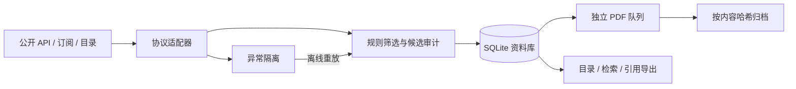

# Quant Research Collector

[English](README.md) | [简体中文](README.zh-CN.md)

[](#快速开始)
[](#快速开始)
[](#核心功能)

**搭建本地、可追溯的量化金融论文与研究报告库。**

从公开 API、RSS 和机构静态目录发现研究材料，按明确规则筛选，保存题录、来源和版本，并归档可公开获取的 PDF。支持中断续采、候选审计、离线重筛和引用导出，无需调用模型或付费 API。

> **定位：**个人研究资料采集管线。免费题录不保证免费全文；完成某个 API 查询窗口，也不代表收齐平台的全部历史材料。

## 目录

- [核心功能](#核心功能)
- [快速开始](#快速开始)
- [常用工作流](#常用工作流)
- [研究来源](#研究来源)
- [工作原理](#工作原理)
- [配置](#配置)
- [命令与退出码](#命令与退出码)
- [资料库与导出](#资料库与导出)
- [维护与定时运行](#维护与定时运行)
- [扩展渠道](#扩展渠道)
- [验证](#验证)
- [已知限制](#已知限制)
- [参与贡献](#参与贡献)
- [文档导航](#文档导航)
- [许可证](#许可证)

## 核心功能

- **确定性筛选：**可编辑的中英文关键词、标题排除词、分类加分及来源独立阈值。分数表示规则匹配程度，不评价论文质量。
- **增量与续采：**独立来源水位、重叠扫描；arXiv、Crossref、DataCite 和 OAI-PMH 支持固定窗口分页恢复。
- **可审计的发现过程：**有容量限制的候选留存、规则判断历史、可选压缩响应快照和离线重新筛选。
- **独立全文队列：**持久化任务、跨来源轮转、重试上限和按主机保存的 `Retry-After` 等待。
- **异常恢复：**隔离单条坏数据，使用当前代码离线重放；无法恢复时可明确记录人工接受的缺口。
- **本地保存：**SQLite、按内容哈希命名的 PDF、完整性检查，以及带校验的 ZIP 备份恢复。
- **便于使用：**本地 HTML/Markdown 目录、全库题录检索、JSON/CSV/BibTeX/RIS 导出。
- **运行环境简单：**Python 3.11+，仅标准库；无需 AI、Embedding、云数据库或模型密钥。

默认覆盖因子与资产定价、组合构建、CTA 与趋势、衍生品与波动率、风险管理、市场微观结构与执行、利率与信用，以及金融统计和机器学习方法。收录机器学习论文，不等于采集程序使用 AI。

## 快速开始

### 环境要求

- **Python 3.11 或更高版本**，没有 `pip install` 步骤。
- 能访问所选来源，且具有有效的 TLS 信任链。
- 用于题录、PDF 和备份的本地可写空间。

已验证环境为 **Windows、Python 3.12.14**。Python 核心入口以跨平台为设计目标，Linux/macOS 尚未获得同等程度的验证；PowerShell 入口和计划任务安装器面向 Windows。

```bash
git clone https://github.com/Arnold3395/quant-research-collector.git
cd quant-research-collector

# 离线查看配置中的来源。
python collector.py sources

# 抽样检查一个来源，不推进资料库水位。
python collector.py doctor --sources arxiv_quant

# 先采题录，创建本地资料库。
python collector.py run --sources arxiv_quant --metadata-only

# 单独处理最多5个符合条件的PDF任务。
python collector.py download --sources arxiv_quant --max-downloads 5
```

用浏览器打开 `data/index.html`。发现题录可能需要数分钟，取决于来源、回看范围和分页预算。Linux/macOS 可按安装情况将 `python` 换成指向 Python 3.11+ 的 `python3`。

Windows 也可使用等价的 PowerShell 入口：

```powershell
.\run.ps1 -Sources arxiv_quant -MetadataOnly
.\run.ps1 -Command download -Sources arxiv_quant -MaxDownloads 5
Start-Process .\data\index.html
```

入口依次寻找项目虚拟环境、本机已有的 Codex 附带 Python、`PATH` 中的 `python`。项目可独立于 Codex 运行；也可用 `-Python 'C:\Python312\python.exe'` 指定解释器。

## 常用工作流

### 采集与检查

```bash
# 扫描全部开启来源，再处理符合条件的全文任务。
python collector.py run

# 在独立资料库内试采，避免混入正式库。
python collector.py run --sources bis_working_papers --metadata-only --data-dir tmp/trial-library

# 本地检查健康状态、趋势和隔离条目。
python collector.py status
python collector.py metrics
python collector.py quarantine --limit 20
```

### 恢复之前被筛掉的候选

修改 `config.toml` 中的关键词规则后执行：

```bash
python collector.py candidates --sources arxiv_quant --limit 20
python collector.py rescreen --sources arxiv_quant
```

`rescreen` 同步已归档记录的规则标签，并将当前通过的留存候选幂等入库。它不联网，也不删除历史记录/PDF。未留存或已过期的候选仍需要重新发现；如果只更新正式库中的标签，可使用 `reclassify`。

### 按固定日期补采历史

```bash
# 按7天分段创建任务，本次最多尝试2个分段。
python collector.py backfill --sources arxiv_quant --from-date 2026-01-01 --until-date 2026-02-01 --chunk-days 7 --max-tasks 2

# 用创建结果中的job_id替换示例，继续已有任务。
python collector.py backfill --job-id bf-YOUR-JOB-ID --max-tasks 2
python collector.py jobs --job-id bf-YOUR-JOB-ID
```

历史任务仅采题录，不推进普通增量水位；没有时区的日期按 UTC 处理。恢复时使用原 job ID，重复创建命令会生成新任务。RSS/静态目录标记为 `limited`，人工接受的未恢复缺口也保持受限状态。接口任务的 `done` 只表示已处理配置查询所提供的窗口。

### 全库检索与引用导出

```bash
python collector.py search --query volatility --pdf-status downloaded --limit 20
python collector.py search --author Smith --topic 组合
python collector.py search --from-date 2025-01-01 --until-date 2026-01-01 --date-field published

python collector.py export --format csv --output tmp/research.csv
python collector.py export --format bibtex --query portfolio --output tmp/portfolio.bib
python collector.py export --format ris --all-versions --output tmp/all-versions.ris
```

检索覆盖正式库全部历史题录，包括已关闭来源的记录，不受最近 HTML 展示窗口限制。多个条件取交集，文本按 Unicode 归一化和大小写无关的字面子串匹配。`--topic` 查询已保存的标签，默认标签为中文。日期范围左闭右开，按指定日期字段筛选时会排除缺失或精度不足的日期。

默认每篇文献返回最近发现的一条匹配记录；`--all-versions` 返回所有匹配来源/版本。检索默认每页50条，导出默认全部匹配结果。输出文件必须不存在。

## 研究来源

当前配置 **10 个平台、12 条默认开启采集流、6 类适配器**，另有3条默认关闭的可选流。入口可用性核验于 **2026-10-16**，可能变化；实际配置和当前运行结果分别以 `sources`、运行报告为准。

| 平台 | 来源 ID | 访问方式及默认全文策略 |
|---|---|---|
| arXiv | `arxiv_quant`、`arxiv_finance_methods` | 官方 API，获取公开 PDF |
| BIS | `bis_working_papers` | RSS/RDF，解析公开 PDF |
| 美联储 | `fed_feds`、`fed_ifdp` | RSS，解析公开 PDF |
| AQR | `aqr_public_research` | 公开研究静态目录 |
| 上交所 | `sse_public_research` | 公开研究与报告静态目录 |
| CFM | `cfm_public_research` | RSS，可解析到公开 PDF 时下载 |
| 加拿大央行 | `bank_canada_working_papers` | 工作论文 RSS |
| Crossref | `crossref_quantitative_finance` | 配置期刊的 DOI 题录，默认仅题录 |
| DataCite | `datacite_quant_research` | 配置查询的仓储 DOI 题录，默认仅题录 |
| EconStor | `econstor_open_research` | OAI-PMH，全文访问单独判断 |

ECB、澳洲联储和瑞士央行的可选流因实测时本机 TLS 信任链问题保持关闭。HAL、OpenAlex、SSRN、微信公众号和券商研报聚合站**尚未接入**。Crossref/DataCite 使用限定查询，不是全平台镜像。

免费题录、免费阅读、可自动下载和允许重新发布全文是不同条件；出版商链接与许可字段不会自动转化为访问权限。

## 工作原理



每个来源保留独立水位与固定窗口检查点。题录保守关联 DOI、arXiv ID、来源标识、URL；缺少直接标识时，使用带冲突检查的标题/首位作者匹配。同一文献可保留多条来源/版本记录，多条记录也可共享一份 PDF。

PDF 使用 SHA-256 命名，复用前检查本地文件；丢失或损坏时可重新排队。文件头与哈希验证格式初检和字节一致性，不证明研究内容正确。

## 配置

编辑 [`config.toml`](config.toml)，或在 [`sources.d/`](sources.d/) 下添加只包含来源定义的片段；`source_files` 相对于主配置解析。`--config` 选择完整 TOML/展开 JSON 配置，`--data-dir` 选择独立资料库。

| 配置项 | 默认值 | 用途 |
|---|---|---|
| `initial_days` / `overlap_days` | `14` / `3` | 首次发现及重叠扫描天数 |
| `max_run_minutes` | `20` | 总网络预算，不是进程硬超时 |
| `discovery_budget_fraction` | `0.65` | 合并运行时发现阶段的预算比例 |
| `source_max_seconds` | `180` | 单来源发现上限，还受剩余预算均分约束 |
| `max_downloads_per_run` / `download_max_per_source` | `30` / `10` | 全局与单来源 PDF 任务处理上限 |
| `retain_candidates` / `candidate_retention_days` | `true` / `90` | 候选审计及保留期限 |
| `candidate_max_mb` | `100` | 候选逻辑负载预算，MiB |
| `retain_raw_responses` / `raw_response_max_mb` | `false` / `50` | 可选压缩题录响应及负载预算 |
| `backlog_alert_days` | `7` | 积压与检查点的关注阈值 |

筛选词表位于 `[filter]` 和 `[filter.topics]`。标题命中每词3分，仅摘要命中1分，`q-fin.*` 类别另加3分，默认阈值2；标题排除词直接拒绝候选。不同主题中重复的词可能重复计分。

候选配额不限制资料库总磁盘占用，也不会自动缩小 SQLite 文件。正式记录、PDF、未解决错误原文、指标历史和备份单独保留。可信自定义 CA 可通过 `ca_file` 配置，TLS 验证始终开启。

## 命令与退出码

| 命令 | 用途 |
|---|---|
| `sources`、`doctor` | 查看配置；联网抽样检查访问与解析 |
| `run`、`download` | 合并采集；独立 PDF 队列 |
| `backfill`、`jobs` | 固定日期任务与持久化进度 |
| `candidates`、`rescreen`、`reclassify` | 候选审计与规则调整 |
| `quarantine`、`replay`、`resolve` | 查询异常、重放保存条目、记录接受的缺口 |
| `search`、`export` | 全库题录检索与引用导出 |
| `status`、`metrics` | 来源健康、趋势、队列和关注项 |
| `verify`、`retry` | 完整性检查/修复，以及指定范围重新排队 |
| `report`、`backup`、`restore` | 重建目录、备份与迁移 |

```bash
python collector.py --help
```

| 退出码 | 含义 |
|---|---|
| `0` | 所选工作正常完成，不表示每条记录都有 PDF |
| `2` | 部分完成、分页待续采、存在关注项或维护检查未通过 |
| `1` | 配置、资料库或运行时致命错误 |
| `130` | 用户中断 |

`continuing` 表示已保存续页位置，不计来源失败；`needs_review` 表示扫描结束，但仍有持久保存的异常项待处理。`no_public_pdf` 表示本次未找到公开全文，不证明免费版本不存在。不联网的命令也可能升级数据库或更新文件，不能一概视为只读。

## 资料库与导出

```text
data/
  library.sqlite3       # 权威文献、来源记录、任务与审计状态
  catalog.jsonl         # 全部来源/版本记录
  index.html            # 可搜索的近期发现页面
  latest.md             # 近期发现目录
  last_run.json         # 最近一次采集执行的历史快照
  pdf/<prefix>/<sha>.pdf
  reports/              # 历史运行报告
  config_history/       # 展开配置快照
  maintenance_history/  # 修复、重筛与人工审核记录
  backups/              # 升级前数据库快照、完整ZIP备份
```

默认 HTML/Markdown 展示**最近7天首次发现**的记录，不是最近7天发表的论文。用 `report --days 30` 扩大展示范围，或通过 `search/export` 查询全部正式归档。摘要来自发布方，不自动生成总结。

仓库只包含程序和配置，不附带预建论文数据库或 PDF 包。运行产生的资料库、文档、日志、备份和本地凭据不会纳入版本控制。

## 维护与定时运行

```bash
python collector.py verify
python collector.py verify --repair
python collector.py retry --sources bis_working_papers
python collector.py backup --output tmp/library-backup.zip
python collector.py restore --archive tmp/library-backup.zip --data-dir data-restored
python collector.py verify --config data-restored/config.expanded.json --data-dir data-restored
```

修复/重试只负责排队，实际获取需执行 `download/run`。恢复目标必须是不存在的新目录。完整 ZIP 包含登记全文、数据库和独立展开配置；自动升级前的数据库快照**不包含 PDF**。

当前数据库结构版本为 **4**。旧库打开时先保存数据库快照，再自动升级；旧程序拒绝打开更高版本的结构。跨机器恢复后应明确指定配置和数据路径。

定时运行由使用者显式启用，克隆或运行采集程序不会安装任务。Windows 可先预览：

```powershell
.\install_schedule.ps1 -Frequency Weekly -Day Monday -At '08:30' -WhatIf
```

已安装的任务采用 Windows 本地时区与当前用户交互登录身份，运行项目 `config.toml`，进程上限30分钟。移除 `-WhatIf` 才会安装。Python 可接入其他系统调度器，但本项目不附带 Linux/macOS 安装脚本。

## 扩展渠道

优先复用已有协议：`rss`、`html`、`arxiv`、`crossref`、`datacite`、`oai_pmh`。新适配器负责把源字段映射为 `Paper/Harvest`，共享代码负责网络、访问策略、存储、检查点和导出。

先用 `doctor` 检查，再通过独立 `--data-dir` 试采并重复运行，验证幂等和恢复行为。新增协议应覆盖空结果、异常条目、协议错误、分页、重复游标、预算中断和续采。落地页、PDF 和重定向域名必须明确加入白名单，不会因接口返回一个网址就自动信任。

配置示例和协议契约见[扩展指南](EXTENDING.md)。

## 验证

截至 **2026-10-17**，Windows/Python 3.12.14 环境下 **110项离线测试通过**：

```bash
python -m unittest discover -s tests -v
```

既有资料库副本完成迁移、检索、导出、备份恢复，保留354条来源/版本记录和39份 PDF。这是特定日期的验证样本，不是附带语料、覆盖率基准或 CI 状态。公开来源访问在2026-10-16另行核验。

对已有资料库，使用 `verify` 和 `python tools/verify_library.py` 分别检查数据库/文件以及导出目录一致性。范围与证据见[验证记录](VALIDATION.md)。

## 已知限制

- 不承诺全网或全历史；订阅窗口、动态网页、远端索引变化和访问限制都可能形成缺口。
- 不模拟登录、不识别验证码、不绕过付费墙，也不自动推断全文使用权限。
- 不提供 AI 排序、翻译、语义搜索、OCR 或 PDF 正文索引；题录检索采用本地顺序筛选。
- 保守身份关联可能保留重复或冲突，需要人工核查。
- 来源/API 改版后可能需要维护；确定性异常提示不是漏采证明。
- 不提供回测、交易信号或券商执行，程序负责采集研究资料。

## 参与贡献

报告问题时请提供运行命令、Python/系统版本、来源 ID、预期行为和脱敏错误。不要上传凭据、非公开研报或整个个人资料库。协议问题尽量使用小型公开或合成样本复现。

修改时保持标准库运行依赖，保留稳定来源 ID 与溯源信息，补充有针对性的离线测试并运行完整测试集。真实来源在独立试验库中验证；离线测试不应依赖外部网站可用。

## 文档导航

| 文档 | 内容 |
|---|---|
| [English README](README.md) | 本项目英文介绍与使用入口 |
| [运行参考手册](docs/REFERENCE.zh-CN.md) | 完整命令、配置和故障排查 |
| [管线手册](PIPELINE.md) | 候选审计、补采、隔离、指标和导出 |
| [扩展指南](EXTENDING.md) | 适配器契约及已探索来源 |
| [验证记录](VALIDATION.md) | 有日期和范围限定的测试、实测证据 |

## 许可证

项目代码许可证尚未指定。第三方论文、研报及来源元数据保留各自的权利和访问条件；发布代码不等于发布或重新授权采集语料。

## README 参考

结构参考 [uv](https://github.com/astral-sh/uv/blob/main/README.md)、[yt-dlp](https://github.com/yt-dlp/yt-dlp/blob/master/README.md) 与 [Pandoc](https://github.com/jgm/pandoc/blob/main/README.md)：先说明用途，提供可执行的快速开始，以常见工作流引导使用，并将深度参考独立成文。内容和能力描述以本项目实际实现为准。
